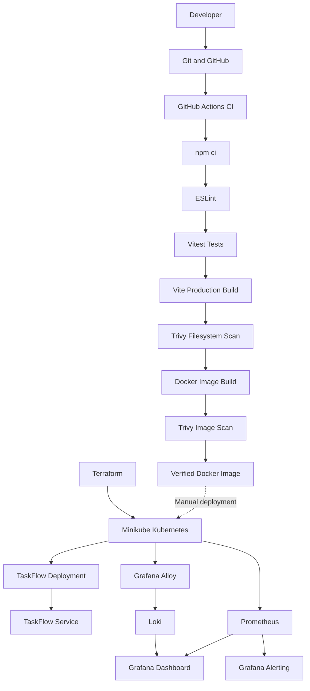

# TaskFlow - DevOps CI/CD Pipeline

A lightweight task management web application built with React and TypeScript, used to demonstrate a practical DevOps workflow. The project integrates automated quality checks, security scanning, Docker containerisation, Kubernetes deployment, Infrastructure as Code, monitoring, logging and alerting.

**Repository:** [task-3-devops-in-action-pipeline](https://github.com/manuelsanjosebelda/task-3-devops-in-action-pipeline)

---

## Project Overview

TaskFlow is a simple browser-based task management application. It allows users to manage tasks through a React interface, with application data stored locally using the browser's LocalStorage.

The main objective of this project is to design and implement a mini CI/CD pipeline that demonstrates key DevOps practices throughout the software delivery lifecycle.

The project includes:

- Source code management with Git and GitHub.
- Automated CI using GitHub Actions.
- Automated testing and code quality checks.
- Security scanning with Trivy.
- Docker image creation and containerisation.
- Kubernetes deployment using Minikube.
- Infrastructure management with Terraform.
- Monitoring with Prometheus and Grafana.
- Log aggregation with Loki and Grafana Alloy.
- Grafana alerting for deployment availability.

## Architecture

The following diagram illustrates the main workflow and the tools used in the project.



The GitHub Actions workflow automates the CI stages and Docker image validation. I perform deployment to the local Minikube cluster separately, while Terraform manages the Kubernetes application resources.

## Technology Stack

| Area                       | Technology             |
| -------------------------- | ---------------------- |
| Frontend                   | React 19, TypeScript   |
| Build tool                 | Vite                   |
| Styling                    | CSS                    |
| Application storage        | Browser LocalStorage   |
| Version control            | Git, GitHub            |
| CI pipeline                | GitHub Actions         |
| Code quality               | ESLint                 |
| Testing                    | Vitest                 |
| Security scanning          | Trivy                  |
| Containerisation           | Docker, Docker Compose |
| Container registry/runtime | Local Docker image     |
| Orchestration              | Kubernetes, Minikube   |
| Infrastructure as Code     | Terraform              |
| Monitoring                 | Prometheus, Grafana    |
| Log aggregation            | Loki                   |
| Log collection             | Grafana Alloy          |
| Package management         | Helm                   |

## Source Code Management

The project uses Git and GitHub for source control and version management.

The repository follows a branch-based workflow:

| Branch          | Purpose                         |
| --------------- | ------------------------------- |
| `main`          | Stable project version          |
| `develop`       | Integration branch              |
| `feature/tasks` | Main feature development branch |

I use meaningful commits to document changes, following conventional commit prefixes where appropriate, such as:

- `feat:` New functionality.
- `fix:` Bug fixes.
- `test:` Test improvements.
- `ci:` Pipeline configuration.
- `security:` Security improvements.
- `docs:` Documentation changes.

The intended integration workflow is feature development, followed by pull requests into `develop` and then `main`.

Repository: [https://github.com/manuelsanjosebelda/task-3-devops-in-action-pipeline](https://github.com/manuelsanjosebelda/task-3-devops-in-action-pipeline)

## Continuous Integration Pipeline

The CI pipeline is defined in `.github/workflows/ci.yml`. It runs on pushes to feature branches, `develop` and `main`, and on pull requests targeting the integration and main branches.

The workflow includes the following stages:

| Stage               | Tool           | Purpose                                  |
| ------------------- | -------------- | ---------------------------------------- |
| Source checkout     | GitHub Actions | Retrieves the repository                 |
| Dependencies        | npm            | Installs dependencies using `npm ci`     |
| Code quality        | ESLint         | Checks code quality and potential issues |
| Automated tests     | Vitest         | Executes the test suite and coverage     |
| Production build    | Vite           | Generates the production application     |
| Filesystem security | Trivy          | Scans the repository for security issues |
| Container build     | Docker         | Builds the application image             |
| Image security      | Trivy          | Scans the Docker image                   |

The security stages are configured to fail the workflow when HIGH or CRITICAL findings meet the configured failure criteria. The pipeline also uses Trivy configuration to exclude development dependencies from package vulnerability scanning. This does not mean development dependencies are vulnerability-free; they are excluded from that particular vulnerability scan.

## Automated Testing

The application uses Vitest for automated testing. The test suite currently contains 20 automated tests, with 100% statement coverage, 95% branch coverage, 100% function coverage and 100% line coverage.

Run the tests locally:

```bash
npm test
```

Run the tests with coverage:

```bash
npm run test:coverage
```

These tests provide automated verification of the application's implemented functionality. They should not be interpreted as end-to-end browser tests.

## Security and Static Analysis

I integrated security checks into the GitHub Actions workflow using Trivy. The project uses Trivy for filesystem vulnerability scanning, secret detection, configuration and misconfiguration scanning, and Docker image vulnerability scanning.

The configuration is stored in `trivy.yaml`. The workflow uses severity-based exit criteria to prevent images with findings at the configured HIGH or CRITICAL levels from passing the security gate.

I also applied Kubernetes security settings to the application deployment, including:

- Non-root container execution.
- Read-only root filesystem.
- Disabled privilege escalation.
- Dropped Linux capabilities.
- RuntimeDefault seccomp profile.

Security findings encountered during development were investigated and addressed where fixes were available.

## Docker Containerisation

TaskFlow is packaged using Docker with a multi-stage Dockerfile. The build stage uses Node.js to install dependencies and generate the production frontend, while the runtime stage uses an unprivileged Nginx Alpine image to serve the static application.

The runtime image is configured to run as a non-root user and uses port `8080`.

Build the image:

```bash
docker build -t taskflow:1.0 .
```

Run the container:

```bash
docker run -d -p 8080:8080 --name taskflow taskflow:1.0
```

Access the application:

`http://localhost:8080`

Docker Compose is also provided for local container execution:

```bash
docker compose up -d --build
```

Stop the services:

```bash
docker compose down
```

The `.dockerignore` file excludes unnecessary files such as `node_modules`, build output, Git metadata and local environment files.

## Kubernetes Deployment

I deployed the application to a local Kubernetes cluster using Minikube. The Kubernetes configuration is stored in the `kubernetes/` directory.

The deployment includes:

- A Kubernetes Deployment with three replicas.
- A Service using NodePort.
- Readiness and liveness probes.
- Resource and container security settings.
- Persistent application availability through multiple replicas.

I load the application image into Minikube before deployment.

Start Minikube:

```bash
minikube start
```

Load the local image:

```bash
minikube image load taskflow:1.0
```

Apply the Kubernetes manifests:

```bash
kubectl apply -f kubernetes/
```

Check the deployment:

```bash
kubectl get deployments
kubectl get pods
kubectl get services
```

Check the rollout:

```bash
kubectl rollout status deployment/taskflow
```

The application can be accessed through the Minikube service:

```bash
minikube service taskflow-service
```

I also tested the deployment by scaling replicas and verifying Kubernetes recovery and rollout behaviour.

## Infrastructure as Code with Terraform

I use Terraform to manage the Kubernetes application resources. The Terraform configuration is stored in the `terraform/` directory.

The Kubernetes Deployment and Service are managed through the Kubernetes Terraform provider and the existing YAML manifests.

Initialise Terraform:

```bash
cd terraform
terraform init
```

Review the planned changes:

```bash
terraform plan
```

Apply the configuration:

```bash
terraform apply
```

I imported the existing Kubernetes resources into Terraform state before managing them. This allows Terraform to track and manage those resources without attempting to create duplicates.

**Scope limitation:** Terraform manages the TaskFlow Kubernetes Deployment and Service. It does not provision the Minikube cluster itself.

Terraform state files and local plan files are excluded from Git through `.gitignore`. The provider lock file is committed to support reproducible provider selection.

## Monitoring with Prometheus and Grafana

I implemented monitoring using the Prometheus and Grafana components installed through Helm. The `kube-prometheus-stack` chart provides Prometheus and Grafana for Kubernetes monitoring.

Add the Helm repository and update it:

```bash
helm repo add prometheus-community https://prometheus-community.github.io/helm-charts
helm repo update
```

Install the monitoring stack:

```bash
helm install monitoring prometheus-community/kube-prometheus-stack \
  --namespace monitoring \
  --create-namespace \
  --wait \
  --timeout 10m
```

Access Grafana locally:

```bash
kubectl port-forward -n monitoring svc/monitoring-grafana 3000:80
```

Open:

`http://localhost:3000`

I created a custom dashboard named **TaskFlow - Kubernetes Monitoring**. It includes panels for available TaskFlow replicas, container CPU usage, container restarts and application logs. The dashboard uses Prometheus metrics to provide visibility into the Kubernetes deployment.

## Log Aggregation with Loki and Grafana Alloy

I implemented centralised logging using Grafana Loki and Grafana Alloy. Loki stores and indexes log labels, while Alloy discovers Kubernetes pods and collects their container logs.

The configuration files are stored in `monitoring/loki/values.yaml` and `monitoring/alloy/values.yaml`. Loki is installed in single-binary mode using filesystem storage and persistent storage configuration suitable for the local Minikube environment.

Alloy discovers TaskFlow pods in the default namespace, collects their logs and forwards them to Loki. Grafana is configured with Loki as an additional data source.

The application logs can be explored in Grafana using the query:

```logql
{namespace="default", pod=~"taskflow-.*"}
```

This provides a central place to inspect application logs alongside Kubernetes metrics.

## Grafana Alerting

I configured Grafana alerting to detect when the TaskFlow deployment has fewer than its expected three available replicas.

The alert rule is named `TaskFlow - Insufficient Replicas` and uses the following Prometheus query:

```promql
kube_deployment_status_replicas_available{
  namespace="default",
  deployment="taskflow"
}
```

The alert condition is:

- Available replicas below 3.
- Pending period of 2 minutes.
- Evaluation interval of 1 minute.

I also configured a Grafana Email Contact Point as the notification destination.

To test the alert, I scaled the TaskFlow Deployment from three replicas to two:

```bash
kubectl scale deployment taskflow --replicas=2
```

After the configured pending period, the alert changed to `Firing`. I then restored the deployment:

```bash
kubectl scale deployment taskflow --replicas=3
```

This test confirmed that Grafana detects a reduction in available replicas and can trigger a notification through the configured contact point.

**Configuration note:** I configured the alert rule and email Contact Point through the Grafana interface. Their configuration has not yet been exported into version-controlled provisioning files, so they need to be recreated if the Grafana installation is replaced.

## Security and Configuration Management

The project follows basic security practices for local development and deployment. These include excluding local environment files, Terraform state and plan files from Git; using Kubernetes container security contexts; running the application container as a non-root user; and scanning source files and container images with Trivy.

The Grafana administrator credential is stored in a Kubernetes Secret generated during the Helm installation.

The project is a local educational implementation. It does not provide a complete production secret-management solution or a centralised external secret manager.

## Project Structure

The main project structure is organised as follows:

```text
task-3-devops-in-action-pipeline/
│
├── .github/
│   └── workflows/
│       └── ci.yml
│
├── kubernetes/
│   ├── deployment.yaml
│   └── service.yaml
│
├── monitoring/
│   ├── alloy/
│   │   └── values.yaml
│   └── loki/
│       └── values.yaml
│
├── terraform/
│   ├── main.tf
│   └── resources.tf
│
├── docs/
│   └── images/
│       └── taskflow-dashboard.png
│
├── src/
│
├── Dockerfile
├── docker-compose.yml
├── .dockerignore
├── .gitignore
├── trivy.yaml
├── package.json
├── package-lock.json
└── README.md
```

## Prerequisites

The following tools are required to reproduce the main project workflow:

- Node.js 22 and npm.
- Git.
- Docker Desktop.
- Trivy.
- kubectl.
- Minikube.
- Helm.
- Terraform.

Some monitoring components require additional resources in Minikube. The local environment should have sufficient memory and CPU allocated before installing the monitoring stack.

## Limitations and Future Improvements

The project demonstrates a practical DevOps workflow, but some parts remain intentionally limited to a local educational environment.

Potential improvements include:

- Automating Kubernetes deployment directly from GitHub Actions.
- Exporting Grafana dashboards and alert rules as provisioning files.
- Adding application-level metrics and health endpoints.
- Expanding automated testing with browser-based end-to-end tests.
- Introducing a remote container registry.
- Using a dedicated secret-management solution.
- Deploying the infrastructure to a cloud Kubernetes service.

These improvements would make the pipeline more suitable for a production environment.

## CI Pipeline Demo

This commit demonstrates the automated GitHub Actions workflow running on a feature branch.
