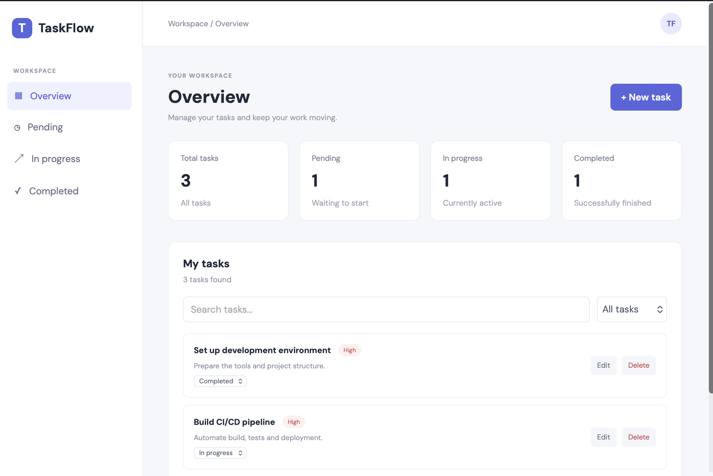
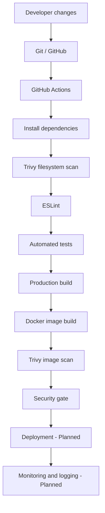

# TaskFlow | DevOps CI/CD Pipeline

**A practical DevOps project demonstrating the implementation of an automated software delivery pipeline.**

TaskFlow is a web application used as the foundation for implementing and demonstrating DevOps practices. The main focus of this project is the design, automation and security of the software delivery lifecycle.

The project progressively integrates source control, automated testing, static analysis, security scanning, containerisation and continuous integration.

<p align="center">
  
</p>

<p align="center">
  
  
  
  
  
</p>

---

## 1. Project Objectives

The objective is to design and implement a practical CI/CD pipeline that demonstrates how modern DevOps practices improve software delivery.

The project follows an incremental approach, introducing automation and security controls throughout the development lifecycle.

The main objectives are:

- Implement source code management using Git and GitHub.
- Automate application builds and testing.
- Integrate static analysis and security scanning.
- Build and manage Docker containers.
- Establish automated deployment.
- Integrate monitoring and logging.

## 2. DevOps Pipeline Architecture

The pipeline is designed around the following stages:



The current implementation automates the process from source code checkout through Docker image construction and security scanning. Deployment and monitoring are planned for subsequent stages.

## 3. Source Code Management

**Tools:** Git and GitHub.

The repository uses a branch-based workflow to organise development.

Current branches:

| Branch          | Purpose                      |
| --------------- | ---------------------------- |
| `main`          | Main project branch          |
| `develop`       | Development integration      |
| `feature/tasks` | TaskFlow feature development |

Changes are organised into meaningful commits using conventional commit messages.

GitHub Actions is configured to trigger on pushes to `feature/**`, `develop` and `main`, and pull requests targeting `develop` and `main`.

Repository: [TaskFlow on GitHub](https://github.com/manuelsanjosebelda/task-3-devops-in-action-pipeline)

## 4. Continuous Integration

**Tool:** GitHub Actions.

The CI workflow is defined in:

`.github/workflows/ci.yml`

The pipeline automatically executes the following stages:

| Stage                   | Tool              | Purpose                                        |
| ----------------------- | ----------------- | ---------------------------------------------- |
| Source checkout         | GitHub Actions    | Retrieve repository source code                |
| Runtime setup           | Node.js 22        | Configure the build environment                |
| Dependency installation | npm               | Install locked dependencies                    |
| Static analysis         | ESLint            | Identify code quality issues                   |
| Automated testing       | Vitest            | Execute unit and integration tests             |
| Coverage                | Vitest Coverage   | Measure test coverage                          |
| Application build       | Vite / TypeScript | Generate production files                      |
| Container build         | Docker            | Build the production image                     |
| Filesystem scanning     | Trivy             | Analyse dependencies and configuration         |
| Image scanning          | Trivy             | Analyse the built container image              |
| Security gate           | Trivy             | Fail the workflow on HIGH or CRITICAL findings |

The workflow separates reporting from enforcement. Trivy generates security reports and applies security gates that can stop the pipeline when serious findings are detected.

## 5. Automated Testing and Quality Assurance

**Tools:** Vitest, React Testing Library and ESLint.

Automated tests are integrated into the CI pipeline to verify application behaviour.

Current test results:

| Metric             |      Result |
| ------------------ | ----------: |
| Test files         |    3 passed |
| Tests              |   20 passed |
| Statement coverage |        100% |
| Branch coverage    | 95% overall |
| Function coverage  |        100% |
| Line coverage      |        100% |

Available commands:

```bash
# Run static code analysis
npm run lint

# Run all tests
npm run test:run

# Run tests and generate coverage
npm run test:coverage

# Build the production application
npm run build
```

## 6. Security and Vulnerability Management

**Tool:** Trivy.

Security scanning is integrated at two levels.

### Filesystem scanning

Trivy analyses the repository for:

- Dependency vulnerabilities.
- Exposed secrets.
- Dockerfile and configuration misconfigurations.

### Container image scanning

After building the Docker image, Trivy analyses its operating system packages and detected components.

### Security controls

The project includes:

- Security gates for HIGH and CRITICAL vulnerabilities.
- Multi-stage Docker builds.
- An unprivileged Nginx runtime using UID 101.
- Updated Alpine system packages.
- A `.dockerignore` file to reduce the Docker build context.

Local image scanning:

```bash
trivy image --severity HIGH,CRITICAL taskflow:1.0
```

The latest recorded local scan reported zero HIGH and CRITICAL vulnerabilities.

## 7. Containerisation

**Tools:** Docker and Nginx.

The application is packaged using a multi-stage Dockerfile.

The build stage uses Node.js 22 Alpine to compile the application. The runtime stage uses an unprivileged Nginx image to serve the production files.

This separates build-time dependencies from the production runtime.

### Build the image

```bash
docker build -t taskflow:1.0 .
```

### Run the container

```bash
docker run -d --name taskflow-app -p 8080:8080 taskflow:1.0
```

Application URL:

`http://localhost:8080`

## 8. Container Management with Docker Compose

Docker Compose is used to define and manage the local application container.

Start the application:

```bash
docker compose up -d --build
```

Check container status:

```bash
docker compose ps
```

View logs:

```bash
docker compose logs
```

Stop the application:

```bash
docker compose down
```

The Compose configuration makes the container environment reproducible without requiring manually constructed Docker commands.

## 9. Deployment and Orchestration

**Status: Planned**

The next stage is to extend the existing CI pipeline towards continuous deployment.

Planned improvements:

- Publish Docker images to GitHub Container Registry (GHCR).
- Use commit-based image tags.
- Implement an automated deployment process.
- Introduce Kubernetes orchestration.
- Document deployment configuration and infrastructure.

## 10. Monitoring and Logging

**Status: Planned**

Monitoring and logging will be introduced after deployment is implemented.

Potential tools include:

- Prometheus for metrics collection.
- Grafana for metrics visualisation.
- Container and application logs for operational troubleshooting.

The objective is to demonstrate how application and infrastructure behaviour can be observed after deployment.

## 11. Technology Stack

| DevOps area                | Technology     |
| -------------------------- | -------------- |
| Source control             | Git            |
| Repository hosting         | GitHub         |
| CI automation              | GitHub Actions |
| Runtime and build          | Node.js        |
| Static analysis            | ESLint         |
| Automated testing          | Vitest         |
| Security scanning          | Trivy          |
| Containerisation           | Docker         |
| Local container management | Docker Compose |
| Production web server      | Nginx          |
| Application framework      | React          |
| Programming language       | TypeScript     |

## 12. Repository Structure

```text
taskflow/
├── .github/
│   └── workflows/
│       └── ci.yml
├── docs/
│   └── images/
│       └── taskflow-dashboard.png
├── src/
│   ├── components/
│   └── App.tsx
├── tests/
│   ├── components/
│   └── integration/
├── .dockerignore
├── Dockerfile
├── compose.yaml
├── trivy.yaml
├── package.json
├── package-lock.json
└── README.md
```

## 13. Project Information

**Course:** Postgraduate Diploma in Science in Computing in DevOps  
**Institution:** Atlantic Technological University (ATU)  
**Module:** DevOps Software Engineering  
**Project:** TaskFlow

**Repository:** [GitHub - TaskFlow](https://github.com/manuelsanjosebelda/task-3-devops-in-action-pipeline)
